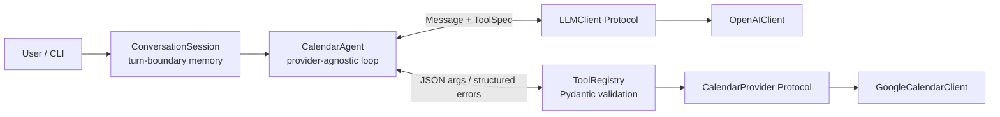

# Calendar AI Agent (From Scratch, No LangChain)

A small, tested, provider-agnostic tool-calling AI agent in Python that manages Google Calendar events through natural language — built incrementally from first principles without any orchestration framework.

Example:
> *"Schedule a meeting with John next Tuesday at 2 PM for one hour."*

The agent resolves relative dates using a deterministic 14-day lookup table, checks availability before writing, guards against conflicts and hallucinated inputs in code, and maintains multi-turn conversation memory.

## Architecture



### Core Modules

| Module | Responsibility |
| --- | --- |
| `src/calendar_agent/models.py` | Domain models (`CalendarEvent`, `CreateEventRequest`), timezone validation, half-open overlap math (`start_a < end_b and start_b < end_a`), guest email validation, and `EventConflictError`. |
| `src/calendar_agent/calendar/` | `CalendarProvider` protocol + `GoogleCalendarClient` adapter (OAuth2 desktop login, `singleEvents=True` recurring expansion, all-day parsing, deterministic conflict guard). |
| `src/calendar_agent/tools.py` | `ToolDefinition`, `ToolRegistry`, Pydantic JSON Schema export (`extra="forbid"`), and structured JSON error recovery (`validation_error`, `conflict`, `calendar_error`). |
| `src/calendar_agent/llm/` | Provider-neutral primitives (`Message`, `ToolCall`, `ToolSpec`, `ModelTurn`, `LLMClient`) + `OpenAIClient` wire adapter. |
| `src/calendar_agent/agent.py` | Core tool-calling loop with `tool_call_id` pairing, step tracing, and `max_steps` safety cap. |
| `src/calendar_agent/prompts.py` | Deterministic temporal grounding (current datetime + DST-aware 14-day date table) and scheduling policy rules. |
| `src/calendar_agent/session.py` | `ConversationSession` and `trim_history_by_turns` (drops whole user turns so `tool_call_id` pairs are never broken). |
| `src/calendar_agent/cli.py` | Interactive terminal REPL (`calendar-agent` / `python -m calendar_agent`) with readable tool-call tracing and `/reset`, `/history`, `/quit`. |

## Setup

### 1. Install dependencies

```bash
python3 -m venv .venv
source .venv/bin/activate
pip install -e ".[dev]"
```

### 2. Configure credentials (for live runs)

1. Set your OpenAI API key:
   ```bash
   export OPENAI_API_KEY="sk-..."
   ```
2. Follow [docs/google-oauth-setup.md](docs/google-oauth-setup.md) to generate `credentials.json` in the repo root (both `credentials.json` and `token.json` are `.gitignore`d).

### 3. Run the CLI

```bash
calendar-agent --timezone America/Los_Angeles
# or:
python -m calendar_agent --timezone America/Los_Angeles --model gpt-4o-mini
```

Useful flags & commands:
- `--quiet`: hide `[tool] ...` trace lines and show only assistant replies.
- `--max-turns 10`: number of complete user turns retained in memory.
- Inside the chat: `/reset` (clear memory), `/history` (show retained turn count), `/quit`.

## Tests & Evals

### Fast deterministic test suite (no API keys or network required)

```bash
pytest -v
```

Tests run against test doubles in `tests/fakes.py` (`InMemoryCalendar` and `FakeLLMClient`) and cover overlap math, Google API mapping, schema validation, structured error recovery, parallel `tool_call_id` pairing, DST transitions, turn-boundary trimming, CLI REPL, and offline eval oracles.

### Live OpenAI eval suite (safe: uses `InMemoryCalendar`)

```bash
RUN_LIVE_EVALS=1 OPENAI_API_KEY="sk-..." pytest -m eval -v
```

Verifies real LLM behavior across 4 state- and trajectory-based scenarios without touching your real Google Calendar:
1. **Happy path:** checks availability first, resolves *"next Tuesday at 3 PM"*, books 60 minutes, and never hallucinates an email for `"John"`.
2. **Conflict blocked:** refuses to double-book over an existing event by default.
3. **Conflict override:** books with `allow_conflicts=true` after explicit multi-turn confirmation.
4. **Clarification guard:** asks for missing required details instead of guessing and booking.